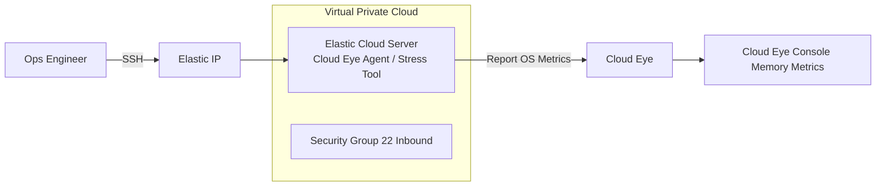

# ECS Memory Metric Sample

[](LICENSE)
[](https://support.huaweicloud.com/intl/en-us/)
[](#)

> Collect operating-system-level memory metrics from a single Elastic Cloud Server via the Cloud Eye agent, and view them in the console.

---

## 1. Overview [CRITICAL]

This reference architecture delivers operating-system-level memory metrics on a single Elastic Cloud Server (ECS) via the Cloud Eye agent, for monitoring and demoing memory usage under load. It targets O&M and security-ops engineers and serves as a learning sample.

### Core Capabilities

- One-click deployment of a single ECS and the Cloud Eye agent
- Operating-system-level memory metric collection and reporting
- Memory usage curves in the Cloud Eye console
- A built-in memory stress tool to demonstrate metric changes under load

---

## 2. Table of Contents [MINOR]

- [1. Overview](#1-overview-critical)
- [2. Table of Contents](#2-table-of-contents-minor)
- [3. Architecture Diagram](#3-architecture-diagram-minor)
- [4. Highlights](#4-highlights-minor)
- [5. Cloud Services](#5-cloud-services-minor)
- [6. Prerequisites](#6-prerequisites-critical)
- [7. Quick Start](#7-quick-start-critical)
- [8. Step-by-Step Deployment](#8-step-by-step-deployment-minor)
- [9. Usage / Verification](#9-usage--verification-critical)
- [10. Cleanup](#10-cleanup-minor)
- [11. Detailed Reference](#11-detailed-reference-minor)
- [12. Dependencies](#12-dependencies-minor)
- [13. FAQ / Troubleshooting](#13-faq--troubleshooting-minor)
- [14. Contributing](#14-contributing-minor)
- [15. License](#15-license-critical)
- [16. Contact](#16-contact-critical)
- [17. Creator / Maintainer](#17-creator--maintainer-critical)

---

## 3. Architecture Diagram [MINOR]

> A single ECS reports memory metrics through the Cloud Eye agent; operators view them in the console.



**Key Components**:

- Elastic Cloud Server (ECS): the OS host running the workload and the Cloud Eye agent
- Cloud Eye Agent: collects and reports memory and other metrics
- Cloud Eye: receives and stores metrics, provides console views

---

## 4. Highlights [MINOR]

- **One-Click Deployment**: Terraform creates all required resources with a single command
- **Memory Metric Visualization**: OS-level memory usage is visible directly in the Cloud Eye console
- **No Long-Lived Keys**: the ECS obtains temporary credentials through the platform-native `cesagency` delegation (created automatically by the "Host Monitoring" one-click setup in the Cloud Eye console, a region-level managed authorization); the agent needs no long-lived key
- **Built-in Stress Demo**: a memory stress tool makes metric changes easy to observe

---

## 5. Cloud Services [MINOR]

| Service | Purpose | Notes |
|---|---|---|
| Virtual Private Cloud (VPC) | Network plane for the ECS | - |
| Elastic Cloud Server (ECS) | Runs the workload and Cloud Eye agent | General computing s6 |
| Elastic IP (EIP) | Public inbound/outbound (SSH inbound / package download) | 5_bgp, traffic-based |
| Security Group | Access control (SSH 22 inbound) | - |
| Cloud Eye Agent Authorization (cesagency delegation) | Temporary credentials for reporting | Platform-managed: created automatically by the "Host Monitoring" setup (region-level, not a Terraform resource here) |
| Cloud Eye (CES) | Metric storage and console views | OS monitoring |

> **Tip**: All services can be created with one click via the Terraform in this repository; for cleanup see [Section 10 "Cleanup"](#10-cleanup-minor).

> **Resource specifications and usage notes**: see [Section 11 "Detailed Reference"](#11-detailed-reference-minor).

---

## 6. Prerequisites [CRITICAL]

| Item | Requirement | Notes |
|---|---|---|
| **Account** | Huawei Cloud account with real-name authentication | Personal / enterprise accounts both OK |
| **Permissions** | Permission to create VPC / ECS / EIP resources | Project-level administrator recommended |
| **Region** | `cn-north-4` recommended | Service availability may differ across regions |
| **Terraform** | `>= 1.5.0` | IaC deployment tool |
| **huaweicloud Provider** | `~> 1.70` | Huawei Cloud Terraform Provider |
| **AK/SK** | Access key created, provided via environment variables at runtime | Do not write credentials into repository files |

> **How credentials are provided**:
> ```bash
> export HW_ACCESS_KEY="<AK>"
> export HW_SECRET_KEY="<SK>"
> ```
> Any `.tf` file or document in the repository uses placeholders only; no real credentials appear.

---

## 7. Quick Start [CRITICAL]

### One-Click Deployment (Recommended)

```bash
# 1. Clone this repository
git clone <repository HTTPS URL> <repo-dir>
cd <repo-dir>

# 2. Configure access credentials (see Prerequisites)
export HW_ACCESS_KEY="<AK>"
export HW_SECRET_KEY="<SK>"

# 3. Deploy
cd infra
terraform init
terraform plan
terraform apply -auto-approve
```

> **Deployment time**: about 5-10 minutes. Full steps and expected output per step: see [Section 8 "Step-by-Step Deployment"](#8-step-by-step-deployment-minor).

---

## 8. Step-by-Step Deployment [MINOR]

### Step 1: Initialize the Working Directory

```bash
cd infra
terraform init
```

**Expected output**: `Terraform has been successfully initialized!`

### Step 2: Preview Resource Changes

```bash
terraform plan
```

**Expected output**: `Plan: 7 to add, 0 to change, 0 to destroy.`

### Step 3: Apply Deployment

```bash
terraform apply -auto-approve
```

**Expected output**: `Apply complete! Resources: 7 added, 0 changed, 0 destroyed.`

### Step 4: Record Key Outputs

```bash
terraform output
```

**Expected output**: lists `ecs_public_ip`, `ecs_id`, `ecs_private_ip`, `region`.

---

## 9. Usage / Verification [CRITICAL]

> **Verification tip**: after deployment, follow this section to confirm memory metrics are collected and visible before treating delivery as complete.

### Verification 1: Log in to the ECS

```bash
ssh root@<ecs_public_ip>
```

### Verification 2: Confirm the Memory Agent Is Running

```bash
systemctl status telescope
free -m
```

**Expected output**: the `telescope` service is `active (running)`; `free -m` prints total and used memory.

### Verification 3: Generate Memory Load and Observe Metrics

```bash
stress --vm 1 --vm-bytes 640M --timeout 300s
```

**Expected result**: while the load is running, open the Cloud Eye console, go to the ECS "OS Monitoring" page, and the memory usage curve should rise noticeably.

### Verification 4: Check the Console

In the Cloud Eye console "OS Monitoring", confirm the "Memory Usage" metric exists with a recent timestamp, showing the reporting path works.

---

## 10. Cleanup [MINOR]

```bash
cd infra
terraform destroy -auto-approve
```

**Expected output**: `Destroy complete! Resources: 7 destroyed.`

> **Avoid resource residue**: `terraform destroy` only releases resources tracked in the Terraform state; manually release any extra resources created in the console.

---

## 11. Detailed Reference [MINOR]

### Workflow

1. On first boot, the ECS runs the `user-data` script: update package sources, install the memory stress tool and the Cloud Eye agent package, then install and start the agent.
2. The Cloud Eye agent obtains temporary credentials through the region-level `cesagency` delegation (authorizing the Cloud Eye internal service account `op_svc_ces`), periodically collects memory usage and other OS metrics, and reports them to Cloud Eye.
3. Operators view the memory usage curve on the Cloud Eye console "OS Monitoring" page; running the stress tool makes the metric rise.

### Configuration Items

| Variable | Default | Notes |
|---|---|---|
| `region` | `cn-north-4` | Deployment region |
| `project_name` | `ecs-memory-metric` | Resource naming prefix |
| `admin_cidr` | `0.0.0.0/0` | SSH inbound CIDR (restrict before delivery) |
| `vpc_cidr` | `10.0.0.0/16` | VPC CIDR block |
| `ecs_flavor` | `s6.large.2` | ECS flavor |
| `image_name` | `Ubuntu 22.04 server 64bit` | Public image name |
| `agent_install_region` | `cn-north-4` | OBS region hosting the Cloud Eye agent package |

---

## 12. Dependencies [MINOR]

### Main Dependencies

| Name | Version | Purpose |
|---|---|---|
| Terraform | `>= 1.5.0` | IaC orchestration |
| huaweicloud Provider | `~> 1.70` | Huawei Cloud resources |
| Cloud Eye Agent | Provided per image region | OS-level metric collection |
| stress | System package | Memory stress demo |

---

## 13. FAQ / Troubleshooting [MINOR]

### Q1: Insufficient permissions during deployment?

**A**: Confirm the account can create VPC / ECS / EIP resources, or at least has administrator rights for those services; first-time use of the Cloud Eye agent may require running the "Host Monitoring" one-click setup in the console to create the region-level `cesagency` delegation.

### Q2: No memory usage metric in the console?

**A**: Confirm the agent is installed and running (`systemctl status telescope`) and the `cesagency` delegation (authorizing `op_svc_ces`) is effective; wait about 1-2 minutes for the first report.

### Q3: Can it scale to multiple instances with auto scaling?

**A**: This practice focuses on the single-instance memory metric path; for horizontal scaling and metric-based elasticity, add auto scaling services and policies on top of this skeleton.

### Troubleshooting Checklist

| Symptom | Possible Cause | Troubleshooting |
|---|---|---|
| SSH cannot log in | Security group lacks port 22 or wrong password | Check `admin_cidr` and the ECS login method |
| Agent not running | Install script failed or wrong region | Check install logs and `agent_install_region` on the instance |
| No metric in console | Missing delegation permission | Verify the `cesagency` delegation has Cloud Eye rights |

---

## 14. Contributing [MINOR]

Issues and PRs are welcome. Please follow this flow:

1. **Issue**: describe the problem or suggestion (with reproduction commands, expected and actual output)
2. **PR**: branch from `main`; run `terraform validate` before submitting
3. **Code Review**: merged after review by a maintainer

---

## 15. License [CRITICAL]

This practice is published under the **MIT No Attribution** license. See the [`LICENSE`](LICENSE) file in the repository root.

> License provenance and related statements are provided with the repository.

---

## 16. Contact [CRITICAL]

| Item | Content |
|---|---|
| **Feedback Channel** | Submit an Issue / PR (see [Section 14](#14-contributing-minor)) |

---

## 17. Creator / Maintainer [CRITICAL]

| Item | Content |
|---|---|
| **Creator** | zhangcheng123321 |
| **Maintainer** | zhangcheng123321 |
