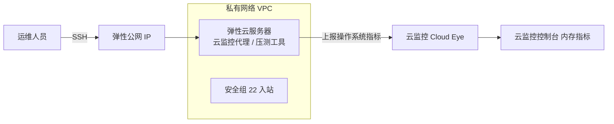

# 弹性云服务器内存指标采集实践 / ECS Memory Metric Sample

<!-- 标准第 1 章 · 标题与徽章 [CRITICAL] -->
[](LICENSE)
[](https://support.huaweicloud.com/intl/en-us/)
[](#)

> 单台弹性云服务器 + 云监控（Cloud Eye）代理，采集操作系统级内存指标并在控制台查看。

---

<!-- 标准第 2 章 · 简介/概述 [CRITICAL] -->
## 1. 简介 / Overview [CRITICAL]

**中文**：本实践提供在单台弹性云服务器上通过云监控（Cloud Eye）代理采集操作系统级内存指标的能力，用于监控与演示内存使用率随负载变化。面向运维与安全运维人员，可作为参考架构与学习样例使用。

**English**: This reference architecture delivers operating-system-level memory metrics on a single Elastic Cloud Server via the Cloud Eye agent, for monitoring and demoing memory usage under load. It targets O&M / security-ops and serves as a learning sample.

### 核心能力

- 单台弹性云服务器与云监控代理一键部署
- 操作系统级内存指标采集与上报
- 云监控控制台查看内存使用率曲线
- 内置内存压测工具，演示指标随负载变化

---

<!-- 标准第 3 章 · 目录 [MINOR] -->
## 2. 目录 [MINOR]

- [1. 简介](#1-简介--overview-critical)
- [2. 目录](#2-目录-minor)
- [3. 架构图](#3-架构图-minor)
- [4. 方案亮点](#4-方案亮点-minor)
- [5. 涉及云服务](#5-涉及云服务-minor)
- [6. 前置条件](#6-前置条件-critical)
- [7. 快速开始](#7-快速开始-critical)
- [8. 分步部署](#8-分步部署-minor)
- [9. 使用方法 / 验证](#9-使用方法--验证-critical)
- [10. 清理资源](#10-清理资源-minor)
- [11. 详细说明](#11-详细说明-minor)
- [12. 依赖](#12-依赖-minor)
- [13. FAQ / 故障排除](#13-faq--故障排除-minor)
- [14. 贡献指南](#14-贡献指南-minor)
- [15. 许可证](#15-许可证-critical)
- [16. 联系方式](#16-联系方式-critical)
- [17. 创建者 / 维护者](#17-创建者--维护者-critical)

---

<!-- 标准第 4 章 · 架构图 [MINOR] -->
## 3. 架构图 [MINOR]

> 单台弹性云服务器通过云监控代理上报内存指标，运维在控制台查看。



**关键组件说明**：
- 弹性云服务器（ECS）：运行负载与云监控代理的操作系统载体
- 云监控代理（Cloud Eye Agent）：采集内存等指标并上报
- 云监控（Cloud Eye）：接收、存储指标并提供控制台查看

---

<!-- 标准第 5 章 · 方案亮点 [MINOR] -->
## 4. 方案亮点 [MINOR]

- **一键部署**：通过 Terraform 一条命令创建全部所需资源
- **内存指标可视化**：操作系统级内存使用率直接在云监控控制台查看
- **无长期密钥**：弹性云服务器通过平台原生的 `cesagency` 委托获取临时凭证（该委托由云监控控制台「主机监控」一键配置自动创建，为区域级平台托管授权），代理无需写入任何长期密钥
- **开箱压测演示**：内置内存压测工具，便于观察指标随负载变化

---

<!-- 标准第 6 章 · 涉及云服务 [MINOR] -->
## 5. 涉及云服务 [MINOR]

| 服务 | 用途 | 备注 |
|---|---|---|
| 私有网络（VPC） | 网络平面承载弹性云服务器 | - |
| 弹性云服务器（ECS） | 运行负载与云监控代理 | 通用计算型 s6 |
| 弹性公网 IP（EIP） | 公网出入（SSH 入站 / 拉取安装包） | 5_bgp 按流量 |
| 安全组 | 访问控制（SSH 22 入站） | - |
| 云监控代理鉴权（cesagency 委托） | 代理上报临时凭证 | 平台托管：由云监控控制台「主机监控」一键配置自动创建（区域级，非本仓库 Terraform 资源） |
| 云监控（Cloud Eye） | 指标存储与控制台查看 | 操作系统监控 |

> **提示**：所有服务均可通过本仓库的 Terraform 一键创建；如需清理，请参见 [第 10 节「清理资源」](#10-清理资源-minor)。

> **资源规格与用量说明**：各服务的规格与部署用量说明见第 11 节「详细说明」。

---

<!-- 标准第 7 章 · 前置条件 [CRITICAL] -->
## 6. 前置条件 [CRITICAL]

| 项 | 要求 | 说明 |
|---|---|---|
| **账号** | 已开通本云平台账号并完成实名认证 | 个人 / 企业账号均可 |
| **权限** | 具备创建私有网络、弹性云服务器、弹性公网 IP 的权限 | 建议项目级管理员或等效权限 |
| **Region** | 推荐 `cn-north-4` | 跨区域可能涉及服务可用性差异 |
| **Terraform** | `>= 1.5.0` | IaC 部署工具 |
| **huaweicloud Provider** | `~> 1.70` | 本云平台 Terraform Provider |
| **AK/SK** | 已创建访问密钥，运行时经环境变量提供 | 请勿写入仓库文件 |

> **凭据提供方式**：
> ```bash
> export HW_ACCESS_KEY="<AK>"
> export HW_SECRET_KEY="<SK>"
> ```
> 仓库内任何 `.tf` / 文档均使用占位符，不出现真实凭据。

---

<!-- 标准第 8 章 · 快速开始/一键部署 [CRITICAL] -->
## 7. 快速开始 [CRITICAL]

### 一键部署（推荐）

```bash
# 1. 克隆本仓库
git clone <本仓库 HTTPS URL> <本仓库根目录>
cd <本仓库根目录>

# 2. 配置访问凭据（见前置条件）
export HW_ACCESS_KEY="<AK>"
export HW_SECRET_KEY="<SK>"

# 3. 一键部署
cd infra
terraform init
terraform plan
terraform apply -auto-approve
```

> **部署耗时**：约 5-10 分钟。完整步骤与每步预期输出参见 [第 8 节「分步部署」](#8-分步部署-minor)。

---

<!-- 标准第 9 章 · 分步部署 [MINOR] -->
## 8. 分步部署 [MINOR]

### 步骤 1：初始化工作目录

```bash
cd infra
terraform init
```

**预期输出**：`Terraform has been successfully initialized!`

### 步骤 2：预演资源变更

```bash
terraform plan
```

**预期输出**：`Plan: 7 to add, 0 to change, 0 to destroy.`

### 步骤 3：执行部署

```bash
terraform apply -auto-approve
```

**预期输出**：`Apply complete! Resources: 7 added, 0 changed, 0 destroyed.`

### 步骤 4：记录关键输出

```bash
terraform output
```

**预期输出**：列出 `ecs_public_ip`、`ecs_id`、`ecs_private_ip`、`region`。

---

<!-- 标准第 10 章 · 使用方法/验证 [CRITICAL] -->
## 9. 使用方法 / 验证 [CRITICAL]

> **验证提示**：部署完成后请按本节步骤自行验证，确认内存指标可正常采集与查看，方可视为交付完成。

### 验证 1：登录弹性云服务器

```bash
ssh root@<ecs_public_ip>
```

### 验证 2：确认内存采集代理已运行

```bash
systemctl status telescope
free -m
```

**预期输出**：`telescope` 服务处于 `active (running)`；`free -m` 输出系统内存总量与已用内存。

### 验证 3：制造内存负载并观察指标

```bash
stress --vm 1 --vm-bytes 640M --timeout 300s
```

**预期结果**：保持负载期间，登录云监控控制台进入对应弹性云服务器的「操作系统监控」页，内存使用率曲线明显抬升。

### 验证 4：控制台核对

在云监控控制台「操作系统监控」中确认存在「内存使用率」指标，且数据时间戳为近期，说明代理上报链路正常。

---

<!-- 标准第 11 章 · 清理资源 [MINOR] -->
## 10. 清理资源 [MINOR]

```bash
cd infra
terraform destroy -auto-approve
```

**预期输出**：`Destroy complete! Resources: 7 destroyed.`

> **避免资源残留**：`terraform destroy` 仅释放由本仓库状态追踪的资源；若曾在控制台手动创建额外资源，请手动释放。

---

<!-- 标准第 12 章 · 详细说明 [MINOR] -->
## 11. 详细说明 [MINOR]

### 工作流程

1. 弹性云服务器首次启动执行 `user-data` 脚本：更新软件源、安装内存压测工具与云监控代理安装包，并完成代理安装与启动。
2. 云监控代理通过区域级 `cesagency` 委托（授权云监控内部服务账户 `op_svc_ces`）的临时凭证，周期性采集内存使用率等指标并上报到云监控。
3. 运维在云监控控制台「操作系统监控」页查看内存使用率曲线；运行压测工具制造内存负载后，可观察到指标上升。

### 配置项

| 变量 | 默认值 | 说明 |
|---|---|---|
| `region` | `cn-north-4` | 部署区域 |
| `project_name` | `ecs-memory-metric` | 资源命名前缀 |
| `admin_cidr` | `0.0.0.0/0` | SSH 入站来源 CIDR（交付前收紧） |
| `vpc_cidr` | `10.0.0.0/16` | 私有网络网段 |
| `ecs_flavor` | `s6.large.2` | 弹性云服务器规格 |
| `image_name` | `Ubuntu 22.04 server 64bit` | 公共镜像名称 |
| `agent_install_region` | `cn-north-4` | 云监控代理安装包所在 OBS 区域 |

---

<!-- 标准第 12 章 · 依赖 [MINOR] -->
## 12. 依赖 [MINOR]

### 主要依赖

| 名称 | 版本 | 用途 |
|---|---|---|
| Terraform | `>= 1.5.0` | IaC 编排 |
| huaweicloud Provider | `~> 1.70` | 本云平台资源 |
| Cloud Eye Agent | 随镜像区域提供 | 操作系统级指标采集 |
| stress | 系统包 | 内存压测演示 |

---

<!-- 标准第 14 章 · FAQ/故障排除 [MINOR] -->
## 13. FAQ / 故障排除 [MINOR]

### Q1：部署时提示权限不足怎么办？

**A**：确认账号具备创建私有网络、弹性云服务器、弹性公网 IP 的权限，或至少具备相应子服务管理员权限；首次使用云监控代理可能需在控制台「主机监控」执行一次一键配置以创建区域级 `cesagency` 委托。

### Q2：控制台看不到内存使用率指标？

**A**：确认代理已安装并运行（`systemctl status telescope`），且 `cesagency` 委托（授权云监控内部服务账户 `op_svc_ces`）已生效；等待约 1-2 分钟首次上报。

### Q3：能否改成多实例与弹性伸缩？

**A**：本实践聚焦单实例内存指标采集链路；如需横向扩展与基于指标的弹性伸缩，可在本骨架之上追加弹性伸缩服务与伸缩策略。

### 故障排查清单

| 现象 | 可能原因 | 排查方法 |
|---|---|---|
| SSH 无法登录 | 安全组未放行 22 或口令错误 | 检查 `admin_cidr` 与弹性云服务器登录方式 |
| 代理未运行 | 安装脚本失败或区域不符 | 登录实例查看安装日志与 `agent_install_region` |
| 控制台无指标 | 委托权限缺失 | 核对 `cesagency` 委托是否已授权 CES 权限 |

---

<!-- 标准第 15 章 · 贡献指南 [MINOR] -->
## 14. 贡献指南 [MINOR]

欢迎提交 Issue 与 PR。请遵循以下流程：

1. **Issue**：描述问题或建议（含复现命令、预期与实际输出）
2. **PR**：基于 `main` 分支新建分支；提交前运行 `terraform validate`
3. **Code Review**：由仓库维护者审核通过后合并

---

<!-- 标准第 16 章 · 许可证 [CRITICAL] -->
## 15. 许可证 [CRITICAL]

本实践采用 **MIT No Attribution** 许可证发布。详见仓库根目录 [`LICENSE`](LICENSE) 文件。

> 许可证溯源与相关声明随仓库提供。

---

<!-- 标准第 16 章 · 联系方式 [CRITICAL] -->
## 16. 联系方式 [CRITICAL]

| 项 | 内容 |
|---|---|
| **反馈渠道** | 提交 Issue / PR（见 [第 14 节](#14-贡献指南-minor)） |

---

<!-- 标准第 17 章 · 创建者/维护者 [CRITICAL] -->
## 17. 创建者 / 维护者 [CRITICAL]

| 项 | 内容 |
|---|---|
| **创建者** | zhangcheng123321 |
| **维护者** | zhangcheng123321 |
