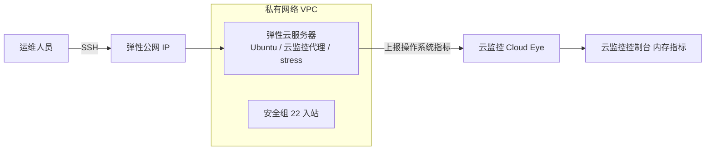

# 架构说明

> 本实践在单台弹性云服务器上通过云监控（Cloud Eye）代理采集操作系统级内存指标，并在云监控控制台查看。内存属于操作系统级指标，基础主机监控不提供，需安装代理后由代理上报。

## 架构总览

## 关键组件说明

| 组件 | 职责 |
|---|---|
| 私有网络（VPC）与子网 | 承载弹性云服务器的网络平面，提供隔离的网段 |
| 安全组 | 放行 SSH（22）入站用于运维，默认允许全部出方向 |
| 弹性公网 IP | 为弹性云服务器提供公网入口（SSH 入站）与公网出口（拉取代理安装包） |
| 弹性云服务器（ECS） | 运行业务负载与云监控代理的操作系统载体 |
| 云监控代理（Cloud Eye Agent） | 采集操作系统级内存等指标并上报到云监控 |
| 云监控（Cloud Eye） | 接收并存储指标，提供控制台查看与告警能力 |

## 工作流程

1. 弹性云服务器首次启动执行 user-data 脚本：更新软件源、安装 `stress` 内存压测工具与云监控代理安装包，并完成代理安装与启动。
2. 云监控代理通过平台原生的区域级 `cesagency` 委托（授权云监控内部服务账户 `op_svc_ces`，由控制台「主机监控」一键配置自动创建）获取临时凭证，周期性采集内存使用率等操作系统指标，上报到云监控。
3. 运维人员在云监控控制台「操作系统监控」页查看内存使用率曲线；运行 `stress` 制造内存负载后，可观察到指标上升。

## 关键设计说明

- **为什么需要代理**：弹性云服务器的基础监控覆盖 CPU、网络等，但不包含内存等操作系统级指标；内存必须由安装在操作系统内的代理采集后上报。
- **代理鉴权**：云监控代理通过平台原生的区域级 `cesagency` 委托（授权云监控内部服务账户 `op_svc_ces`）获取临时凭证；该委托由云监控控制台「主机监控」一键配置自动创建，为区域级平台托管授权，无需在镜像或脚本中写入任何长期密钥，也无需在本仓库 Terraform 中创建。
- **压测工具**：`stress` 仅用于演示内存指标随负载变化，生产环境可按需移除。
- **单实例拓扑**：本实践聚焦单台实例的内存指标采集链路；如需横向扩展与基于指标的弹性伸缩，可在本骨架之上追加弹性伸缩服务与伸缩策略。
